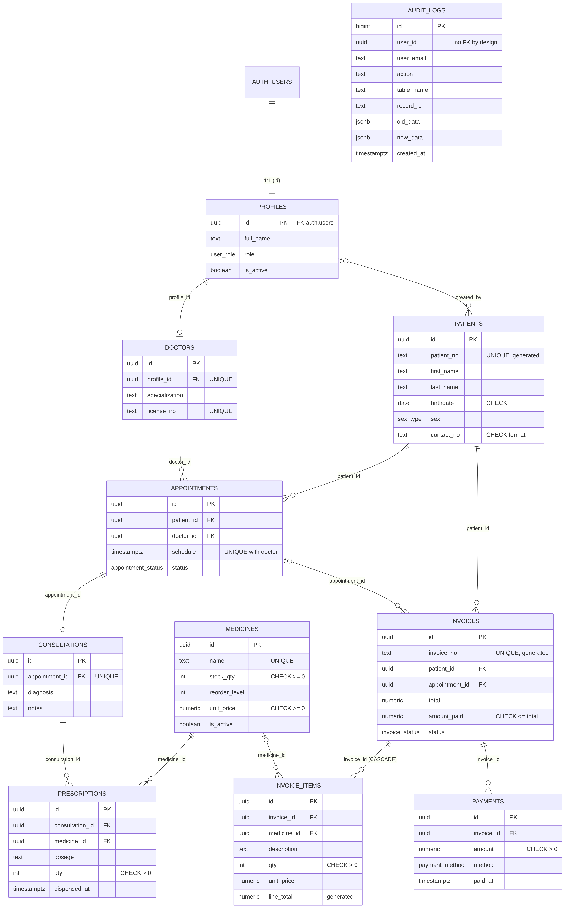

# ERD - CareNova Family Clinic

Source: `docs/erd.mmd` (Mermaid). The diagram follows `supabase/migrations/0001_schema.sql`. Vector version: `ERD.svg`.
Not drawn, to keep the picture readable: the `created_by` / `dispensed_by` / `received_by` columns (FK to `profiles`, `ON DELETE SET NULL`) and the `*_seq` identity helper columns.

## Tables
| Table | Purpose | Key constraints |
|---|---|---|
| profiles | One row per login (1:1 with `auth.users`), holds role and active flag | PK = FK to auth.users, role enum, `full_name` not blank |
| doctors | Doctor details, only for profiles with role doctor | `profile_id` UNIQUE, `license_no` UNIQUE, trigger checks role |
| patients | Patient records | generated `patient_no` UNIQUE, CHECK on birthdate and phone format |
| medicines | Catalog and stock | `name` UNIQUE, CHECK `stock_qty >= 0`, `unit_price >= 0` |
| appointments | Patient + doctor + time | partial UNIQUE `(doctor_id, schedule) WHERE status <> 'cancelled'` |
| consultations | At most one per appointment | `appointment_id` UNIQUE, diagnosis not blank |
| prescriptions | Medicines prescribed in a consultation | CHECK `qty > 0`, locked after dispensing |
| invoices | Bills | generated `invoice_no` UNIQUE, CHECK `amount_paid <= total` |
| invoice_items | Lines of an invoice | `line_total` generated = qty x unit_price |
| payments | Money received | CHECK `amount > 0`, immutable (no update/delete) |
| audit_logs | Audit trail | append-only, no FK on purpose |

## Relationships and delete rules
- Business records use `ON DELETE RESTRICT`: a patient, doctor, medicine, appointment, consultation or invoice that is referenced cannot be deleted.
- `invoice_items` is the only `ON DELETE CASCADE` (items belong to their invoice).
- `created_by`-style columns use `SET NULL`, so removing a user never deletes clinical history.
- `audit_logs` has no foreign key: log rows survive even if the user is removed.

## Normalization (3NF)
- Each fact is stored once: patient details live only in `patients`, doctor details in `doctors`/`profiles`, prices in `medicines` (the item keeps its own `unit_price` as the price at the time of billing, an intentional snapshot).
- Many-to-many relation medicine <-> consultation is resolved by `prescriptions`; medicine <-> invoice by `invoice_items`.
- Derived values are generated or trigger-maintained and cannot be written by clients: `patient_no`, `invoice_no`, `line_total`, `invoices.total`, `amount_paid`, `status`.
